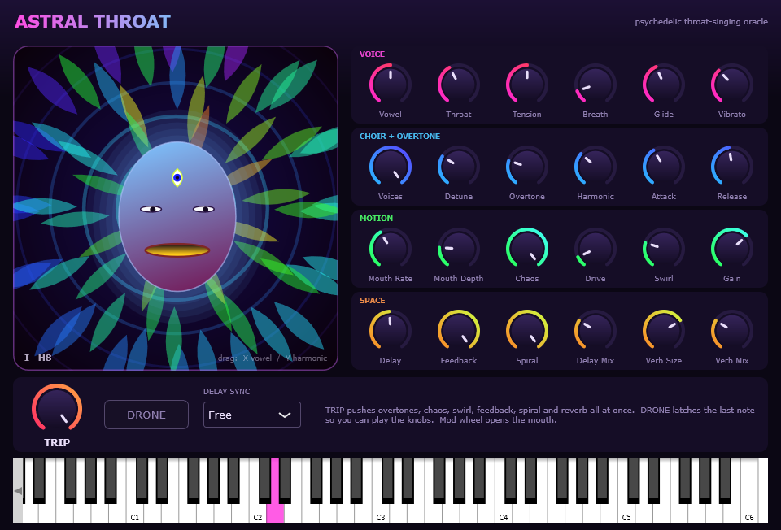

# Astral Throat

A psychedelic throat-singing vocal synth. VST3 instrument + standalone app for Windows, built with JUCE.



A monophonic singing voice you steer by vowel, with an animated three-eyed oracle that sings along.

- **Voice** - formant synthesis morphing through U-O-A-E-I, with glide, vibrato, breath and throat size.
- **Choir** - up to 5 detuned unison voices, each with a slightly different throat, spread in stereo.
- **Overtone singing** - a resonator that picks out harmonics 4-16 of the note, khoomei style.
- **Motion** - a mouth LFO and a Lorenz-attractor chaos source that wander the vowel, harmonic and delay time.
- **Space** - drive, phaser, a ping-pong delay whose repeats spiral up or down in pitch, and reverb. Delay can sync to host tempo.
- **TRIP** - one macro that pushes overtones, chaos, swirl, feedback, spiral and reverb together.
- **DRONE** - latches the last note so you can play the knobs.
- **XY pad** - drag on the oracle: X is vowel, Y is harmonic. The mod wheel opens the mouth.

## Install

Run `AstralThroat-Setup-<version>.exe` from [Releases](../../releases): it installs the VST3 plugin and the standalone app.

Or grab the zip, then:

- copy `Astral Throat.vst3` to `C:\Program Files\Common Files\VST3` and rescan plugins in your DAW, or
- run `Astral Throat.exe` (standalone, has an on-screen keyboard).

## Build

Requires Visual Studio 2022 Build Tools (C++ workload, which includes CMake and Ninja).

```
git clone --recursive <this repo>
build.bat
```

`build.bat` expects the Build Tools in their default install location; edit the `vcvars64.bat` path if yours differs. Outputs land in `build\AstralThroat_artefacts\Release`.

`RenderTest.exe <outdir>` renders a short phrase to WAV, checks levels, and snapshots the editor to PNG.

## License

AGPL-3.0, see [LICENSE](LICENSE). Built on the [JUCE](https://juce.com) framework (AGPLv3).
